# Plataforma distribuida para la gestión de un laboratorio clínico

Proyecto final integrador de **Aplicaciones Distribuidas** (UTA). Integra las unidades 1 a 4: clientes y componentes distribuidos, concurrencia y procesamiento distribuido, acceso público, seguridad y nube, y servicios SOA, REST y SOAP.

- **Portal de pacientes (Flutter Web):** <https://labclinico-uta.duckdns.org>
- **Sistema transaccional (Angular):** <https://labclinico-uta.duckdns.org/admin/>
- **Contrato SOAP (WSDL):** <https://labclinico-uta.duckdns.org/soap?wsdl>

> Las máquinas virtuales se apagan cuando no se usan para cuidar el crédito de Azure for Students. Si el enlace no responde, enciéndalas con `infra/vms.ps1 encender`.
> Todos los datos clínicos son **ficticios**.

---

## Por dónde empezar

| Si quiere ver… | Abra |
|---|---|
| El informe completo (investigación, diseño, resultados y conclusiones) | [docs/00-informe-tecnico.md](docs/00-informe-tecnico.md) |
| **Qué se decidió y por qué** (decisiones D1–D35, cronología, hallazgos) | [docs/BITACORA.md](docs/BITACORA.md) |
| Fase I: análisis de requerimientos, actores y casos de uso | [docs/01-analisis-requerimientos.md](docs/01-analisis-requerimientos.md) |
| Fases II y III: arquitectura, modelo ER, normalización y replicación | [docs/02-arquitectura-y-datos.md](docs/02-arquitectura-y-datos.md) |
| Diccionario de datos (generado desde la base) | [docs/03-diccionario-datos.md](docs/03-diccionario-datos.md) |
| Fases V, VII y VIII: endpoints REST, SOAP, Stripe y Mailjet | [docs/04-servicios-rest-soap.md](docs/04-servicios-rest-soap.md) |
| Fase X: las 10 pruebas con métricas | [docs/05-pruebas-experimentales.md](docs/05-pruebas-experimentales.md) |
| **Base de conocimientos para diagnósticos** (reglas CIE-10, protocolos, guías, precisión) | [docs/06-base-conocimiento.md](docs/06-base-conocimiento.md) |

## Arquitectura

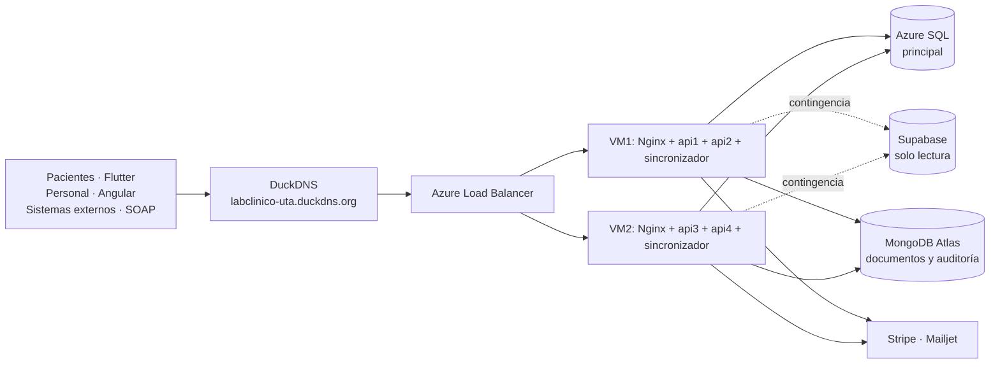

**Piezas principales:**
- **Base principal:** Azure SQL. **Réplicas:** Supabase y MongoDB Atlas, sincronizadas con **Change Tracking** por un sincronizador propio que corre en ambas VM y elige un líder.
- **APIs:** 4 instancias Flask (REST + SOAP) en Docker, detrás de Nginx y del Azure Load Balancer.
- **Seguridad:** JWT con varios roles por persona, HTTPS de Let's Encrypt y limitador de intentos de login.
- **Pagos:** Stripe en modo prueba (con reembolsos) y transferencia con QR. **Correo:** Mailjet.
- **Base de conocimientos:** sistema experto basado en reglas (sin IA). Al registrar resultados sugiere diagnósticos CIE-10 explicados, con protocolo y guía clínica (MongoDB); el médico acepta o descarta, y eso mide la precisión de cada regla.

## Capturas y evidencias

| | |
|---|---|
| 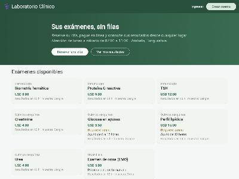 <br/>Portal de pacientes publicado | 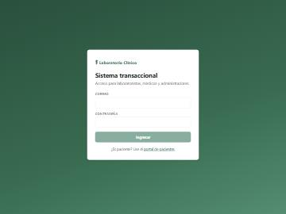 <br/>Sistema transaccional publicado |
| 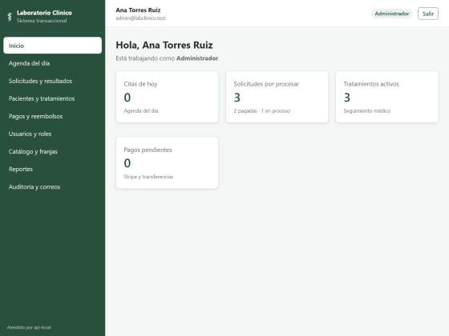 <br/>Administrador: indicadores | 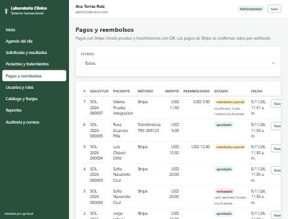 <br/>Pagos, rechazos y reembolsos |
| 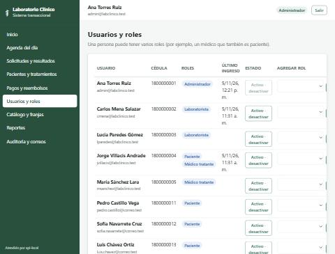 <br/>Usuarios con varios roles (médico y paciente) | 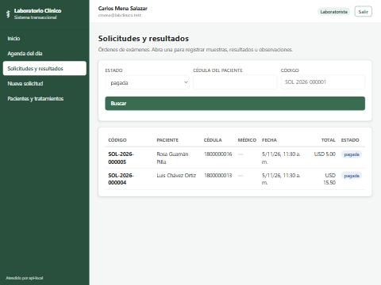 <br/>Laboratorista: solicitudes pagadas |
| 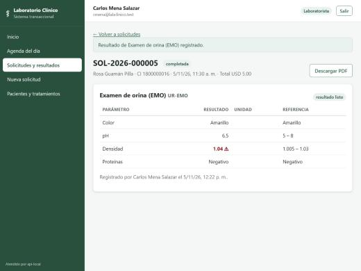 <br/>Resultado registrado con un valor fuera de rango | 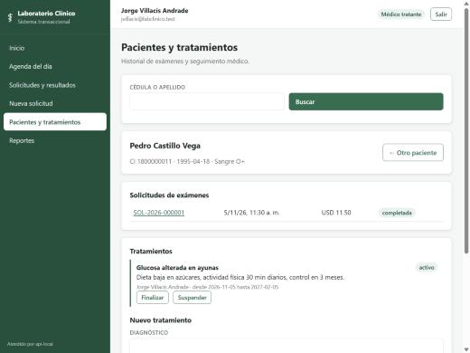 <br/>Médico: historial y tratamientos |
| 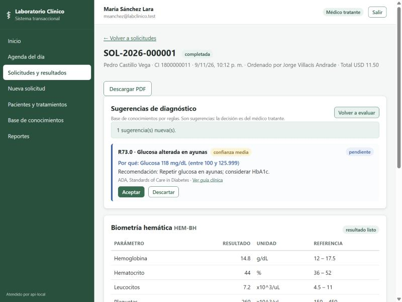 <br/>Base de conocimientos: diagnóstico sugerido y explicado | 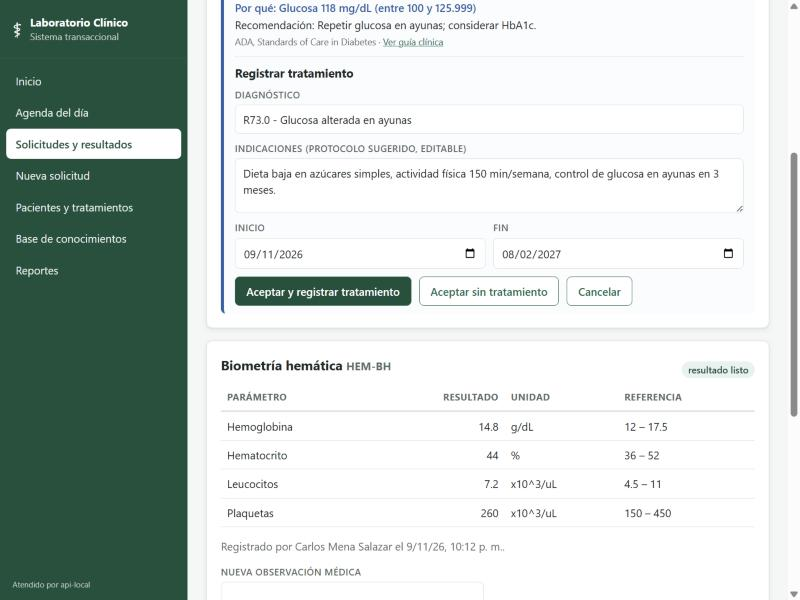 <br/>Aceptar la sugerencia: tratamiento con el protocolo |
| 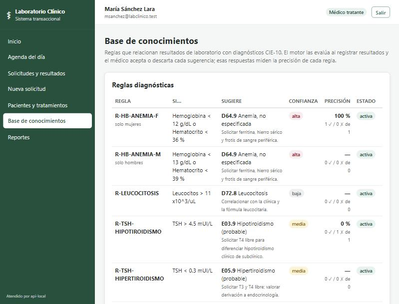 <br/>Reglas diagnósticas con su precisión | |

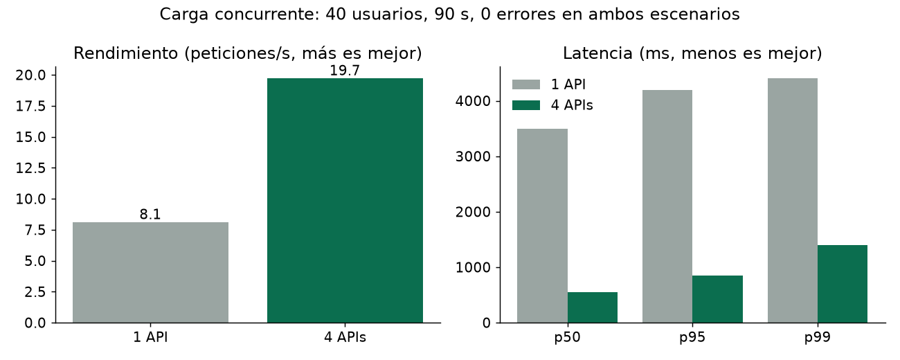
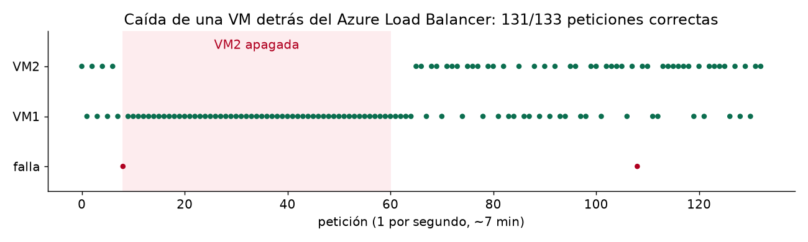

Las salidas completas de cada prueba (JSON, CSV de Locust, el PDF del flujo completo y la consola del cliente SOAP) están en [`pruebas/resultados/`](pruebas/resultados).

## Cumplimiento de la rúbrica

| Criterio | Evidencia |
|---|---|
| 1. Análisis y diseño | `docs/01`, `docs/02`, `docs/03`, diagrama de arquitectura |
| 2. Bases de datos y replicación | `database/`, `sync-worker/`; réplica verificada 27/27 tablas y 5/5 colecciones; ponerse al día tras apagarse, incluidos los borrados |
| 3. Infraestructura y alta disponibilidad | `infra/`; 2 VM, 4 APIs, Azure Load Balancer con sonda; caída de una API (16/16) y de una VM (131/133) |
| 4. REST, SOAP y concurrencia | `api/`, `clientes/soap_cliente.py`; reservas simultáneas: sin protección 6 citas en 3 cupos, con protección 3 + 3 rechazadas |
| 5. Aplicaciones web y servicios externos | `portal-pacientes/` (Flutter), `web-admin/` (Angular), Stripe (sandbox), Mailjet, PDF |
| 6. Seguridad y acceso público | DuckDNS + Let's Encrypt, JWT y roles, limitador, credenciales fuera del código; `pruebas/seguridad.py` 17/17 |
| 7. Pruebas experimentales | `pruebas/` y `docs/05`: 1 frente a 4 APIs, caída de Azure SQL, réplica y flujo completo (15/15) |
| Extra: base de conocimientos | `docs/06`; reglas en Azure SQL replicadas a Supabase, guías en MongoDB; `pruebas/base_conocimiento.py` 18/18 |
| 8. Documentación y defensa | Este repositorio, el informe y la bitácora |

## Estructura

```
api/               APIs Flask (REST + SOAP, Stripe, Mailjet, PDF) + Dockerfile
sync-worker/       sincronizador Azure SQL -> Supabase + MongoDB (Change Tracking)
database/          scripts de Azure SQL (01–07), Supabase y MongoDB
infra/             docker-compose.yml, Nginx, certificado, generar_env.py, vms.ps1
web-admin/         Angular 22 · sistema transaccional
portal-pacientes/  Flutter 3.47 · portal de pacientes
clientes/          cliente SOAP independiente (zeep)
pruebas/           scripts de las pruebas en la nube y sus resultados
docs/              informe, fases, bitácora y capturas
```

## Cómo ejecutarlo

1. **Bases de datos:**
   - Azure SQL: ejecutar `database/azure-sql/01`–`04`, `06` y `07`, por ejemplo con `database/ejecutar_azure_sql.py`;
   - Supabase: los tres scripts de `database/supabase/`;
   - MongoDB: `mongosh … database/mongodb/init_mongo.js` y `guias_clinicas.js`.
2. **Credenciales:** llenar `secretos/credenciales.env`, que no está en el repositorio, y generar los `.env` de cada VM con `python infra/generar_env.py`. Las plantillas están en los `*.env.example`.
3. **En cada VM:**
   ```
   cd /opt/laboratorio/infra
   docker compose up -d --build
   ```
4. **Frontends:**
   - `cd web-admin && npx ng build`, y copiar el resultado a `web/admin/`;
   - `cd portal-pacientes && flutter build web --release --no-web-resources-cdn`, y copiar el resultado a `web/portal/`.

**Usuarios de prueba** (contraseña `Lab2026*`): `admin@labclinico.test`, `cmena@labclinico.test` (laboratorista), `jvillacis@labclinico.test` (médico y también paciente), `pedro.castillo@correo.test` (paciente).

> **Seguridad:** este repositorio no contiene ninguna credencial real. Contraseñas, tokens y claves viven solo en `secretos/` y en los `.env` de las VM, que están excluidos por `.gitignore`.
