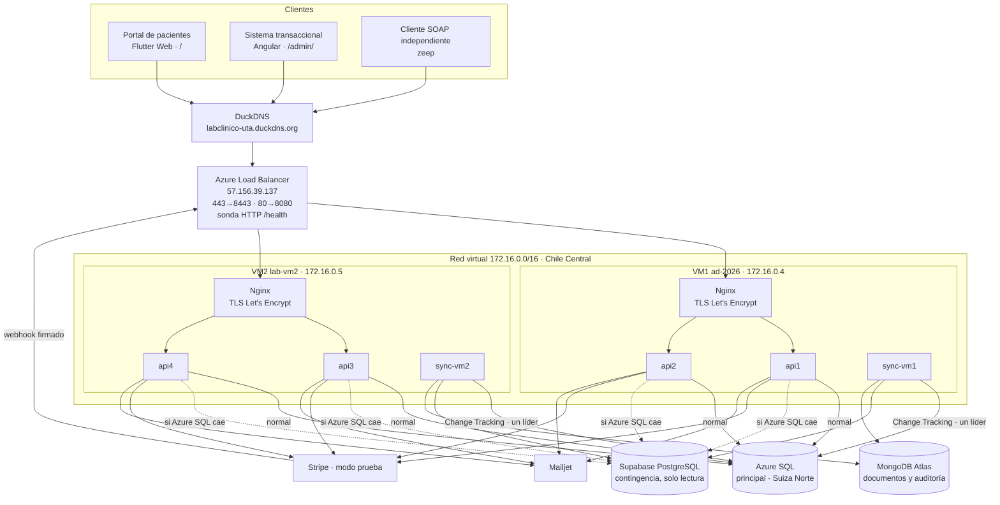

# Informe técnico — Plataforma distribuida para la gestión de un laboratorio clínico

**Asignatura:** Aplicaciones Distribuidas — Universidad Técnica de Ambato
**Modalidad:** investigación, análisis, diseño, desarrollo e implementación práctica (unidades 1 a 4)
**Sistema publicado:** <https://labclinico-uta.duckdns.org> (portal de pacientes) · <https://labclinico-uta.duckdns.org/admin/> (sistema transaccional)
**Datos:** todos los datos clínicos del sistema son ficticios.

Este informe resume el proyecto. El detalle de cada fase está en los documentos enlazados:

| Documento | Contenido |
|---|---|
| [01-analisis-requerimientos.md](01-analisis-requerimientos.md) | Fase I: actores, casos de uso, procesos, requerimientos y riesgos |
| [02-arquitectura-y-datos.md](02-arquitectura-y-datos.md) | Fases II y III: arquitectura, modelo de datos, normalización y replicación |
| [03-diccionario-datos.md](03-diccionario-datos.md) | Diccionario de datos generado desde la base real |
| [04-servicios-rest-soap.md](04-servicios-rest-soap.md) | Fases V, VII y VIII: endpoints REST, servicio SOAP e integraciones |
| [05-pruebas-experimentales.md](05-pruebas-experimentales.md) | Fase X: las 10 pruebas con métricas y evidencias |
| [BITACORA.md](BITACORA.md) | Registro cronológico, decisiones (D1–D27) y su justificación |

---

## 1. Objetivo y alcance

Se diseñó e implementó una plataforma distribuida para un laboratorio clínico.

**Usuarios:**
- **Pacientes:** usan un portal en Flutter Web.
- **Personal** (laboratoristas, médicos tratantes y administradores): usa un sistema transaccional en Angular.

**Backend:** 4 instancias de API Flask (REST + SOAP) en 2 máquinas virtuales de Azure, detrás de Nginx y del Azure Load Balancer, con:
- **Azure SQL Database** como base principal;
- **Supabase** como base de contingencia de solo lectura;
- **MongoDB Atlas** como réplica documental y de auditoría;
- **Stripe** (modo prueba) para pagos y **Mailjet** para correos.

Todos los objetivos del enunciado se implementaron y se verificaron en la nube. Lo único que no se pudo probar de forma automatizada es el pago con tarjeta en la página de Stripe, porque requiere que una persona escriba los datos de la tarjeta de prueba; la sección 7 lo detalla.

## 2. Investigación

### 2.1 El laboratorio clínico
El ciclo de atención sigue estos pasos:
1. agendamiento en franjas con capacidad limitada (muchos exámenes exigen ayuno);
2. orden de exámenes con precio fijado;
3. pago previo;
4. toma de muestra y análisis por parámetro;
5. comparación con rangos de referencia y entrega;
6. seguimiento por el médico tratante (observaciones y tratamiento).

Los actores, los 21 casos de uso, los 20 requerimientos funcionales y los 12 no funcionales están en el documento 01.

**Hallazgo clave del análisis:** el ingeniero indicó que **una misma persona puede tener varios roles**; por ejemplo, un médico puede atenderse como paciente. El modelo lo resuelve con una persona, una cuenta y N roles, y valida el conflicto de interés: nadie puede tratarse ni registrar resultados para sí mismo.

### 2.2 Alternativas tecnológicas evaluadas

| Necesidad | Alternativas | Elegida y motivo |
|---|---|---|
| Replicación Azure SQL → Supabase y MongoDB | Polling por fecha, triggers + outbox, CDC, Debezium/Kafka, Azure Data Sync | **Change Tracking + sincronizador propio**: funciona en cualquier nivel de Azure SQL, detecta borrados y, tras apagarse, se pone al día solo (D1) |
| Pasarela de pagos | Stripe, PayPal Sandbox | **Stripe**: reembolsos totales y parciales, tarjetas de prueba para rechazos y webhooks firmados (D4) |
| Correo | Brevo, Mailjet | **Mailjet** (elección del equipo; el enunciado acepta un equivalente) |
| SOAP en Python | spyne, implementación propia | **WSDL propio + defusedxml**: compatible con Python 3.12 y protegido contra XXE (D9) |
| Balanceo entre VM | Azure Load Balancer, Traffic Manager, Front Door | **Azure Load Balancer** (lo exige la rúbrica). Obligó a que las 2 VM estén en la misma red virtual (D16) |
| Certificado | DNS-01 (DuckDNS), HTTP-01 | **HTTP-01 con reto compartido entre VM** (D24) |

El diseño se contrastó además con un segundo modelo de IA (Gemini 4 Argon, por la CLI de Antigravity). De esa revisión se adoptaron:
- lecturas en SNAPSHOT;
- copia histórica de precios y rangos de referencia;
- el rol con el que actuó cada usuario en la auditoría;
- la expiración de citas no pagadas.

## 3. Diseño

### 3.1 Arquitectura desplegada



| Componente | Tecnología y versión |
|---|---|
| Portal de pacientes | Flutter 3.47 (Dart 3.13), Material 3, CanvasKit servido desde el propio dominio |
| Sistema transaccional | Angular 22 (standalone, signals, sin Zone.js) |
| APIs | Python 3.12, Flask 3.1, Gunicorn (2 procesos × 4 hilos), pyodbc (ODBC Driver 18), psycopg 3, PyJWT, bcrypt, Stripe 16, ReportLab, segno, defusedxml |
| Sincronizador | Python 3.12, pyodbc, psycopg 3, pymongo |
| Contenedores | Docker 29.9, Compose v5.7 (un solo `docker-compose.yml` para ambas VM) |
| Proxy y TLS | Nginx 1.27 (resolución dinámica de upstreams, limitador de login, HSTS), certbot |
| Infraestructura | 2 VM B2als_v2 (Ubuntu 24.04), Azure Load Balancer Standard, NSG, Azure SQL serverless (oferta gratuita), Supabase (PostgreSQL 17), MongoDB Atlas (8.0) |

### 3.2 Modelo de datos
- **Tamaño:** 25 tablas en 3FN, con desnormalización controlada y justificada (precio y rango histórico, contador de cupos).
- **Integridad:** PK, FK, `CHECK`, índices únicos filtrados y `rowversion`.
- **Procedimientos:** 15 procedimientos almacenados transaccionales con `TRY/CATCH` y errores de negocio `THROW 50xxx`, que la API traduce a códigos HTTP.
- Detalle en los documentos 02 y 03.

### 3.3 Servicios
Siete servicios REST, cada uno con su prefijo y contrato: autenticación, citas, exámenes y resultados, pagos, tratamientos, notificaciones y administración. A ellos se suma un **servicio SOAP 1.1** con WSDL publicado y 3 operaciones. Ver el documento 04.

## 4. Implementación

### 4.1 Mecanismos distribuidos

| Mecanismo | Implementación | Dónde |
|---|---|---|
| **Balanceo en 2 niveles** | Azure Load Balancer entre VM (sonda `/health`), y Nginx entre las 2 APIs de cada VM con reintento ante errores de conexión | `infra/` |
| **Tolerancia a fallos** | Si cae una API, Nginx la retira; si cae una VM, la sonda del balanceador la retira; los contenedores se reinician solos | `docker-compose.yml`, plantilla de Nginx |
| **Contingencia de datos** | *Circuit breaker* en cada API: ante fallo de conexión, las lecturas van a Supabase con un rol de solo lectura y las escrituras responden 503; vuelve sola a Azure SQL | `api/app/db.py` |
| **Replicación** | Change Tracking leído en SNAPSHOT; la versión se guarda en cada destino (en Supabase, en la misma transacción que los datos); upserts idempotentes; documentos desnormalizados en Mongo con `FOR JSON`; carga completa automática si se supera la retención | `sync-worker/` |
| **Alta disponibilidad del sincronizador** | Uno por VM, pero solo replica el que tiene el candado `sp_getapplock`; si cae, el otro toma el relevo | `origen.py` |
| **Concurrencia** | `sp_reservar_cita` con `UPDLOCK, HOLDLOCK` + `CHECK (ocupados <= capacidad)` + índice único filtrado; el envío de correos usa `UPDLOCK + READPAST`; webhooks idempotentes | `03_procedimientos.sql` |
| **Pool de conexiones** | 8 por proceso, validadas si estuvieron ociosas, con reintento solo en lecturas | `db.py` |

### 4.2 Seguridad
- **HTTPS:** Let's Encrypt, TLS 1.2/1.3, HSTS, y redirección de HTTP a HTTPS.
- **Autenticación:** JWT HS256 de 8 h; contraseñas con bcrypt de costo 12; bloqueo tras 5 intentos fallidos; limitador de 10 logins por minuto por IP (429).
- **Autorización:** por rol activo (`X-Rol-Activo`). El paciente solo accede a sus propios datos y los procedimientos validan el conflicto de interés.
- **Bases de datos con mínimo privilegio:**
  - Azure SQL: `app_api` y `app_sync`, y firewall solo con las IP de las VM y del equipo;
  - Supabase: esquema `lab` fuera de la Data API, RLS y roles `lab_sync` y `lab_lectura` (este último de solo lectura);
  - Atlas: lista de IP permitidas.
- **Credenciales:** solo en archivos `.env` con permisos 600, generados desde `secretos/` (excluido del repositorio). Las contraseñas internas son aleatorias.
- **Pagos:** la tarjeta nunca pasa por el sistema (Stripe Checkout) y los webhooks se validan con su firma y se procesan una sola vez.
- **SOAP:** clave en cabecera SOAP y `defusedxml` contra XXE.

### 4.3 Despliegue
- `docker-compose.yml` es igual en ambas VM; solo cambia `infra/.env` (`vm1`: api1/api2, `vm2`: api3/api4).
- Los `.env` se generan con `infra/generar_env.py`.
- Restricción respetada: **en VM1 solo se agregó** (puertos 8080/8443, carpeta `/opt/laboratorio`). Apache y WordPress de la Unidad 2 siguen funcionando.
- Las VM se encienden y apagan con `infra/vms.ps1` para cuidar el crédito de Azure for Students.

## 5. Resultados

Todas las pruebas se ejecutaron en la nube. Los scripts y evidencias están en `pruebas/` y `pruebas/resultados/`.

| # | Prueba | Resultado |
|---|---|---|
| 1–2 | 1 API frente a 4 APIs (Locust, 40 usuarios, 90 s) | **4 APIs: 19,7 req/s, p50 550 ms, p95 850 ms**. 1 API: 8,1 req/s, p50 3 500 ms. Ambas con 0 errores |
| 3 | Reservas simultáneas (6 pacientes, 3 cupos) | Sin protección: 6 citas y el contador en 1. **Con protección: 3 reservadas y 3 rechazadas, consistente** |
| 4 | Caída de una API | 16/16 peticiones atendidas por las otras 3 |
| 5 | Caída de una VM (`az vm stop`) | 131/133; solo falló la petición que estaba en curso |
| 6–7 | Caída de Azure SQL | Lecturas desde Supabase y escrituras con 503; **recuperación automática en ~8 s** |
| 8 | Consistencia de la réplica | 22/22 tablas en Supabase y 5/5 colecciones en Mongo; la misma versión de Change Tracking |
| 9 | REST y SOAP | Cliente SOAP independiente: las 3 operaciones; REST cubierto por todas las pruebas |
| 10 | Seguridad y roles | **17/17** sobre `labclinico-uta.duckdns.org` |
| — | **Flujo completo** (`flujo_completo.py`) | Registro → cita → exámenes → sesión real de Stripe → transferencia confirmada → resultados → observación y tratamiento → PDF. **Réplica en 4 s** y **3 correos reales enviados** por Mailjet |
| — | Relevo del sincronizador | El líder detenido es reemplazado en ~38 s; un cambio se replica a Mongo en ~14 s |
| — | Integración local de la API | 56/56 verificaciones |

## 6. Limitaciones, fallos encontrados y acciones tomadas

Las pruebas encontraron problemas reales. Todos se corrigieron y quedaron documentados:

| Fallo encontrado | Causa | Acción |
|---|---|---|
| Las VM del equipo estaban en redes virtuales distintas (incluso en suscripciones distintas) | Cada VM se creó por separado | Nueva VM2 en la red de VM1 (D16). Al no alcanzar la cuota Spot, se creó con prioridad normal (D17) |
| Cada petición tardaba ~3,4 s y había falsas caídas | Azure SQL está en Suiza; abrir una conexión cuesta 2–3 s y el timeout era de 3 s | Pool de conexiones y timeout de 8 s: ~1,1 s (D22). En Chile Central no existe la base gratuita (D21) |
| 502 al caer una API | Nginx guardaba las IP internas del arranque | `resolve` con el DNS de Docker (D23) |
| El sincronizador alternaba el liderazgo | La sesión quedaba en SNAPSHOT y `READPAST` fallaba | Se restablece READ COMMITTED después de cada lote |
| Nginx no encontraba el certificado | `.env` con saltos de línea de Windows (`\r`) | Generación con `newline="\n"` |
| La simulación de caída de Azure SQL no tenía efecto | El firewall de Azure SQL tarda hasta 5 min en aplicarse | Regla NSG temporal de salida + `KILL` de sesiones (D26) |
| El portal Flutter quedaba en blanco | CanvasKit se descargaba de un CDN externo y no llegaba | Compilación con `--no-web-resources-cdn` |
| Login 503 bajo carga | Limitador de Nginx (comportamiento esperado) | Se devuelve 429 y la prueba reutiliza tokens (D27) |

**Limitaciones conocidas:**
- **Latencia hacia Azure SQL en Suiza:** ~0,2 s por consulta, lo que limita la escalabilidad medida.
- **Relevo del sincronizador en ~38 s:** no se pierden datos gracias a Change Tracking.
- **Contingencia de solo lectura:** en contingencia no se pueden reservar citas ni pagar (lo pide el enunciado).
- **VM1 es Spot:** Azure puede desalojarla. VM2 es normal para garantizar el servicio.
- **Certificado de Let's Encrypt de 90 días:** se renueva con `infra/certificado.sh`.

## 7. Pendiente al cierre

- **Pago con tarjeta desde el portal:** el sistema crea la sesión real de Stripe y el webhook está registrado y probado con firma. Falta que una persona complete el pago en la página de Stripe con la tarjeta de prueba `4242 4242 4242 4242`.

## 8. Conclusiones

1. **Separar la lectura de la escritura permite seguir atendiendo cuando la base principal cae.** La réplica en Supabase, con un rol de solo lectura, sostuvo login, resultados, PDF y SOAP durante la caída de Azure SQL, y la recuperación fue automática.
2. **Change Tracking más un sincronizador idempotente es una solución de replicación simple y robusta** para este caso: detecta borrados, sobrevive a apagados y no exige servicios pagados ni cambios en la aplicación.
3. **La escalabilidad horizontal se verificó con números:** 4 APIs multiplicaron por 2,4 el rendimiento y redujeron 6 veces la latencia mediana, sin errores. El límite restante es la distancia a la base de datos, no las APIs.
4. **La concurrencia debe resolverse en la base de datos:** la prueba sin bloqueos produjo sobre-reserva y actualización perdida, que la transacción con `UPDLOCK/HOLDLOCK` eliminó.
5. **Las pruebas en la nube encontraron errores que las pruebas locales no veían** (latencia, IP de contenedores, aislamiento de sesión, CDN). Probar en el entorno real y documentar cada hallazgo fue clave.

**Recomendaciones de mejora:**
- mover Azure SQL a la región de las VM, con nivel pagado o un VNet privado;
- usar un registro de imágenes y CI/CD para desplegar;
- manejar los secretos con Azure Key Vault;
- monitorear con Azure Monitor o Prometheus;
- renovar el certificado automáticamente;
- permitir escrituras diferidas (cola) durante la contingencia.

## 9. Anexos

### 9.1 Estructura del repositorio
```
database/      azure-sql (01–06), supabase, mongodb, ejecutar_azure_sql.py, generar_diccionario.py
sync-worker/   sincronizador (Change Tracking -> Supabase y MongoDB)
api/           APIs Flask (REST + SOAP) + Dockerfile
infra/         docker-compose.yml, nginx/, certificado.sh, generar_env.py, vms.ps1
web-admin/     Angular (sistema transaccional)
portal-pacientes/  Flutter Web (portal de pacientes)
clientes/      soap_cliente.py
pruebas/       scripts de las pruebas y resultados/
docs/          documentación y bitácora
secretos/      credenciales (NO se entrega ni se sube a ningún repositorio)
```

### 9.2 Usuarios de prueba (datos ficticios, contraseña `Lab2026*`)

| Rol | Correo |
|---|---|
| Administrador | `admin@labclinico.test` |
| Laboratorista | `cmena@labclinico.test` |
| Médico (también paciente) | `jvillacis@labclinico.test` |
| Paciente | `pedro.castillo@correo.test` |

### 9.3 Cómo repetir las pruebas
```
.\infra\vms.ps1 encender
python pruebas/seguridad.py
python pruebas/flujo_completo.py
python pruebas/verificar_replicacion.py
python pruebas/concurrencia.py 6 800
python pruebas/caida_azure_sql.py 60
locust -f pruebas/locustfile.py --host https://labclinico-uta.duckdns.org --headless -u 40 -r 10 -t 90s
.\infra\vms.ps1 apagar
```
