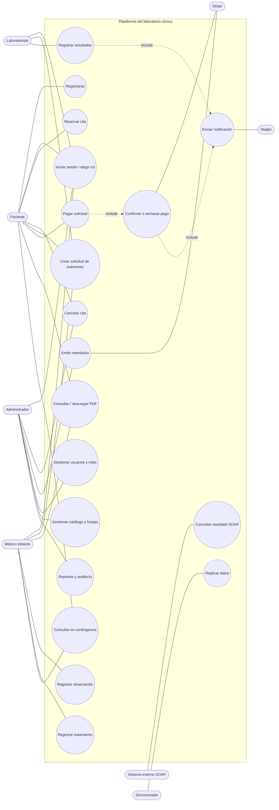

# Fase I — Análisis de requerimientos

**Proyecto:** Plataforma distribuida para la gestión de un laboratorio clínico
**Asignatura:** Aplicaciones Distribuidas — UTA
**Datos:** todos los datos usados son ficticios.

---

## 1. Funcionamiento general de un laboratorio clínico

Un laboratorio clínico recibe pacientes, que llegan por su cuenta o con una orden médica. Toma muestras biológicas (sangre, orina, etc.), las procesa y entrega los resultados al paciente y a su médico tratante. El ciclo típico es este:

1. **Agendamiento:** el paciente elige fecha y hora. Muchos exámenes requieren ayuno, por eso la atención se concentra en la mañana y se organiza en franjas con capacidad limitada.
2. **Orden de exámenes:** se registra qué exámenes se realizarán. El precio queda fijado al momento de la orden.
3. **Pago:** se cobra antes de procesar la muestra.
4. **Toma de muestra y análisis:** el laboratorista procesa la muestra y registra los valores obtenidos para cada parámetro del examen.
5. **Validación y entrega:** cada valor se compara con su rango de referencia, y el paciente recibe una notificación cuando todos sus resultados están listos.
6. **Seguimiento médico:** el médico tratante revisa los resultados, registra observaciones e indica un tratamiento.

En el laboratorio intervienen tres tipos de procesos:

- **Administrativos:** citas, cobros, reembolsos, usuarios y reportes.
- **Operativos:** muestras, análisis y resultados.
- **Tecnológicos:** disponibilidad, réplica de datos, seguridad, notificaciones y pasarela de pagos.

## 2. Actores y responsabilidades

| Actor | Tipo | Responsabilidades |
|---|---|---|
| **Paciente** | Humano | Registrarse, reservar y cancelar citas, pagar en línea, consultar y descargar sus resultados (PDF), ver sus tratamientos. |
| **Laboratorista** | Humano | Ver la agenda del día, registrar la toma de muestra, registrar los resultados por parámetro y registrar pacientes en ventanilla. |
| **Médico tratante** | Humano | Ordenar exámenes, revisar los resultados de sus pacientes, registrar observaciones y tratamientos. |
| **Administrador** | Humano | Gestionar usuarios, roles y permisos, el catálogo de exámenes y las franjas, emitir reembolsos y ver reportes y auditoría. |
| **Stripe** | Sistema externo | Procesar pagos con tarjeta (modo prueba), emitir reembolsos y avisar por webhook. |
| **Mailjet** | Sistema externo | Enviar correos (confirmación de cita, pago, resultados listos). |
| **Sistema externo (SOAP)** | Sistema externo | Consultar resultados por código de solicitud (por ejemplo, una aseguradora o una clínica aliada). |
| **Sincronizador** | Proceso interno | Replicar los cambios de Azure SQL hacia Supabase y MongoDB Atlas. |

### 2.1 Personas con varios roles

Una misma persona puede tener **varios roles a la vez**. Por ejemplo, un médico o un laboratorista también puede atenderse como paciente. El modelo lo resuelve así:

- `persona` (una fila por cédula) tiene como máximo **un** `usuario`, y ese usuario tiene **N roles** (`usuario_rol`).
- Cada rol tiene su propio perfil (`paciente`, `medico`, `laboratorista`), vinculado a la persona con `persona_id UNIQUE`.
- Al iniciar sesión, el token JWT lleva **todos** los roles. Si la persona tiene más de uno, la interfaz le permite elegir con qué rol trabajar; cada operación se audita con el `rol_actuante`.
- **Conflicto de interés:** un médico no puede registrarse tratamientos ni observaciones a sí mismo, y un laboratorista no puede registrar sus propios resultados. Esto lo validan los procedimientos almacenados.

## 3. Casos de uso

| ID | Caso de uso | Actor principal |
|---|---|---|
| CU-01 | Registrarse en el portal | Paciente |
| CU-02 | Iniciar sesión y elegir el rol activo | Todos |
| CU-03 | Consultar el catálogo de exámenes y sus indicaciones | Paciente (público) |
| CU-04 | Reservar una cita en una franja disponible | Paciente |
| CU-05 | Cancelar una cita | Paciente, Administrador |
| CU-06 | Crear una solicitud de exámenes | Paciente, Médico, Laboratorista |
| CU-07 | Pagar una solicitud (Stripe Checkout o transferencia con QR) | Paciente |
| CU-08 | Confirmar o rechazar un pago (webhook) | Stripe |
| CU-09 | Emitir un reembolso total o parcial | Administrador |
| CU-10 | Registrar la toma de muestra | Laboratorista |
| CU-11 | Registrar resultados | Laboratorista |
| CU-12 | Consultar y descargar los resultados en PDF | Paciente, Médico |
| CU-13 | Registrar una observación médica | Médico |
| CU-14 | Registrar un tratamiento | Médico |
| CU-15 | Gestionar usuarios, roles y permisos | Administrador |
| CU-16 | Gestionar el catálogo de exámenes y las franjas | Administrador |
| CU-17 | Ver reportes y auditoría | Administrador, Médico |
| CU-18 | Enviar notificaciones por correo | Sistema (Mailjet) |
| CU-19 | Consultar un resultado vía SOAP | Sistema externo |
| CU-20 | Consultar en modo contingencia (Azure SQL caído) | Paciente, Médico |
| CU-21 | Replicar datos hacia Supabase y MongoDB | Sincronizador |

### 3.1 Diagrama de casos de uso

## 4. Procesos principales

### 4.1 Registro de pacientes y reserva de citas
1. El paciente se registra con su cédula, datos personales, correo y contraseña. Si la cédula ya existe (por ejemplo, la de un médico), no se duplica la persona: solo se agrega el perfil y el rol **PACIENTE**.
2. Consulta las franjas disponibles (capacidad menos ocupados).
3. Reserva una cita: `sp_reservar_cita` bloquea la franja (`UPDLOCK, HOLDLOCK`), valida el cupo, incrementa `ocupados` e inserta la cita en estado `PENDIENTE_PAGO`.
4. Si no paga en 30 minutos, el sincronizador ejecuta `sp_expirar_citas_pendientes`, que cancela la cita y libera el cupo.

### 4.2 Gestión de exámenes, solicitudes y resultados
1. Se crea la solicitud con uno o más exámenes del catálogo, y el precio de cada uno queda congelado en el detalle.
2. Una vez pagada, el laboratorista registra la toma de muestra y luego los valores de cada parámetro.
3. Al registrar los valores se copia el rango de referencia vigente y se marca `fuera_rango`.
4. Cuando todos los exámenes de la solicitud tienen resultado, la solicitud pasa a `COMPLETADA` y se encola el correo "resultados listos".

### 4.3 Procesamiento y registro de pagos (Stripe en modo prueba)
1. Se registra la **solicitud de pago**: la API crea una sesión de Stripe Checkout y un `pago` en estado `PENDIENTE`.
2. El paciente paga en la página segura de Stripe; el laboratorio nunca ve los datos de la tarjeta.
3. Stripe confirma por **webhook**. La API verifica la firma `Stripe-Signature`, guarda el evento en `stripe_evento` (idempotencia) y ejecuta `sp_confirmar_pago`.
4. Si el pago se aprueba, se **actualizan los estados**: el pago queda `APROBADO`, la solicitud `PAGADA` y la cita `CONFIRMADA`, y se **notifica** al paciente.
5. Los **pagos rechazados** (por ejemplo, tarjeta declinada) quedan en `RECHAZADO` con su motivo y se notifica al paciente, que puede reintentar. Los **no confirmados** (sesión vencida) quedan en `EXPIRADO`.
6. El administrador puede emitir un **reembolso** total o parcial; se registra en `reembolso` y el estado del pago pasa a `REEMBOLSADO` o `REEMBOLSO_PARCIAL`.

### 4.4 Observaciones y seguimiento médico
El médico revisa los resultados de sus pacientes, registra observaciones sobre un resultado e indica un tratamiento (diagnóstico, indicaciones, fechas y estado).

### 4.5 Generación y descarga de reportes PDF
- **Paciente:** informe de resultados por solicitud, con valores, unidades, rangos y los valores fuera de rango resaltados.
- **Administrador o médico:** reportes de ingresos, exámenes por período y pacientes atendidos.

Los PDF se generan en la API (WeasyPrint o ReportLab) bajo demanda.

### 4.6 Administración de usuarios, roles y permisos
El administrador crea usuarios, asigna o quita roles (`sp_asignar_rol` crea el perfil que corresponda) y activa o bloquea cuentas. Los permisos se asignan a los roles (`rol_permiso`), y los permisos efectivos de un usuario son la unión de los permisos de todos sus roles.

## 5. Requerimientos funcionales

| ID | Requerimiento |
|---|---|
| RF-01 | El sistema permitirá registrar pacientes validando que la cédula sea única. |
| RF-02 | El sistema autenticará con correo y contraseña (bcrypt) y emitirá un JWT con los roles del usuario. |
| RF-03 | Una persona podrá tener varios roles y elegir el rol activo en la interfaz. |
| RF-04 | El sistema mostrará las franjas disponibles y permitirá reservar sin superar la capacidad. |
| RF-05 | El sistema permitirá cancelar citas y liberará el cupo. |
| RF-06 | Las citas no pagadas expirarán automáticamente a los 30 minutos. |
| RF-07 | El sistema gestionará el catálogo de exámenes, sus parámetros y sus rangos de referencia. |
| RF-08 | El sistema permitirá crear solicitudes con uno o varios exámenes y calculará el total. |
| RF-09 | El sistema procesará pagos con Stripe en modo prueba y transferencia con QR simulada. |
| RF-10 | El sistema confirmará los pagos por webhook de forma idempotente. |
| RF-11 | El sistema gestionará pagos rechazados, expirados y reembolsos totales o parciales. |
| RF-12 | El laboratorista registrará resultados por parámetro y el sistema marcará los valores fuera de rango. |
| RF-13 | El médico registrará observaciones y tratamientos, sin poder hacerlo sobre sí mismo. |
| RF-14 | El paciente consultará y descargará sus resultados en PDF. |
| RF-15 | El sistema enviará correos con Mailjet (cita, pago aprobado o rechazado, resultados listos). |
| RF-16 | El sistema expondrá un servicio SOAP con WSDL para consultar resultados desde sistemas externos. |
| RF-17 | El administrador gestionará usuarios, roles y permisos. |
| RF-18 | El sistema auditará las operaciones relevantes (usuario, rol, acción, instancia de API). |
| RF-19 | Los datos se replicarán automáticamente hacia Supabase y MongoDB Atlas. |
| RF-20 | Si Azure SQL no está disponible, las consultas permitidas seguirán funcionando desde Supabase en solo lectura. |

## 6. Requerimientos no funcionales

| ID | Categoría | Requerimiento |
|---|---|---|
| RNF-01 | Disponibilidad | 4 instancias de API Flask en 2 VM; el servicio continúa si cae una instancia o una VM. |
| RNF-02 | Disponibilidad | Si Azure SQL cae, se detecta en ≤ 3 s y se pasa a modo contingencia (lectura desde Supabase). |
| RNF-03 | Consistencia | Ninguna franja puede superar su capacidad aunque haya reservas simultáneas. |
| RNF-04 | Replicación | Replicación incremental con retraso ≤ 10 s; tras un apagado del sincronizador, se pone al día solo. |
| RNF-05 | Seguridad | HTTPS con Let's Encrypt en un dominio DuckDNS; JWT con expiración; autorización por rol en cada endpoint. |
| RNF-06 | Seguridad | Las bases de datos solo aceptan conexiones desde las VM; las credenciales viven en `.env` y nunca en el código. |
| RNF-07 | Seguridad | Los datos de tarjeta nunca pasan por el sistema (Stripe Checkout); los webhooks se validan con su firma. |
| RNF-08 | Rendimiento | p95 < 500 ms en las consultas con 50 usuarios concurrentes y 4 APIs. |
| RNF-09 | Trazabilidad | Logs estructurados (JSON) por instancia; auditoría replicada a MongoDB. |
| RNF-10 | Portabilidad | Todo se despliega con Docker Compose de forma reproducible. |
| RNF-11 | Interoperabilidad | REST con JSON y SOAP con XML y WSDL publicado. |
| RNF-12 | Usabilidad | Interfaces responsivas; el portal del paciente funciona en el navegador del móvil. |

## 7. Análisis de riesgos

| Riesgo | Tipo | Impacto | Mitigación |
|---|---|---|---|
| Dos pacientes reservan el último cupo al mismo tiempo | Concurrencia | Sobre-reserva | Transacción con `UPDLOCK/HOLDLOCK`, `CHECK (ocupados <= capacidad)` e índice único filtrado por paciente y franja. Probado: sin protección quedan 4 citas en una franja de 3; con protección, la tercera reserva se rechaza. |
| Dos laboratoristas editan el mismo resultado | Concurrencia | Se pierde una edición | Concurrencia optimista con `rowversion`. |
| Stripe reenvía el mismo webhook | Integridad | Pago procesado dos veces | La tabla `stripe_evento` (PK = id del evento) y el procedimiento son idempotentes. |
| Cae Azure SQL | Disponibilidad | Sin servicio | Circuit breaker en la API y lectura desde Supabase con un rol de solo lectura. |
| Cae una API o una VM | Disponibilidad | Peticiones fallidas | Nginx (2 upstreams por VM) y Azure Load Balancer con health probe. |
| El sincronizador se detiene | Replicación | Réplicas desactualizadas | Change Tracking guarda los cambios 14 días; al volver se pone al día. Puede correr una instancia en cada VM con un candado de líder (`sp_getapplock`). |
| Escritura parcial durante la réplica | Integridad | Réplica inconsistente | En Supabase los datos y la versión se guardan en una sola transacción; en Mongo las operaciones son idempotentes y la versión avanza al final. |
| Fuga de credenciales | Confidencialidad | Acceso no autorizado | `.env` fuera del repositorio, usuarios de base con mínimo privilegio y firewall de Azure SQL restringido a las IP de las VM. |
| Exposición de datos clínicos | Confidencialidad | Violación de privacidad | Los pacientes solo ven sus propios datos (validado en la API), HTTPS, el esquema de Supabase no está expuesto en la Data API, y se usan datos ficticios. |
| Supabase pausa el proyecto gratuito por inactividad | Disponibilidad | Contingencia inútil | El sincronizador escribe cada pocos segundos y mantiene el proyecto activo. |
