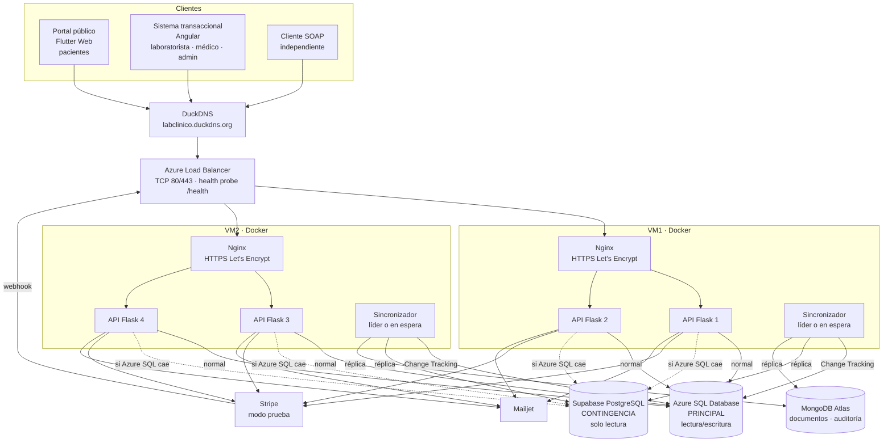
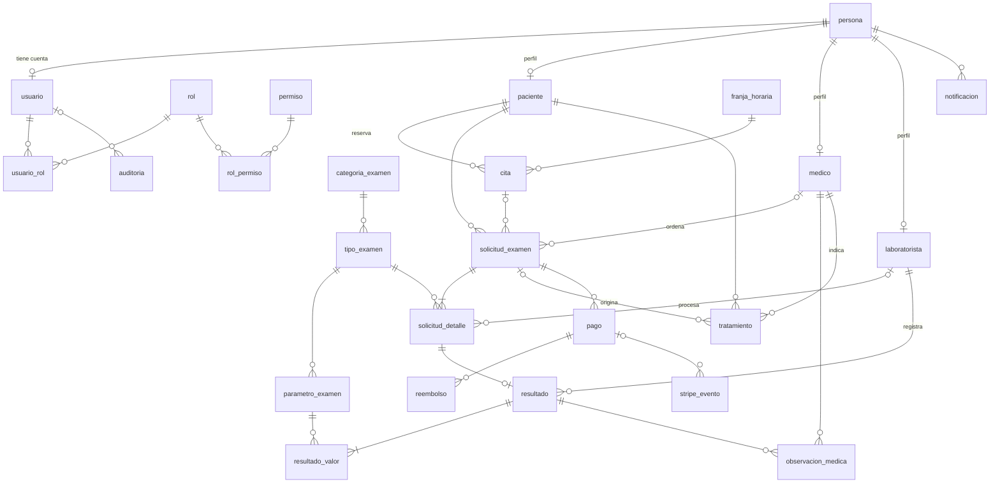
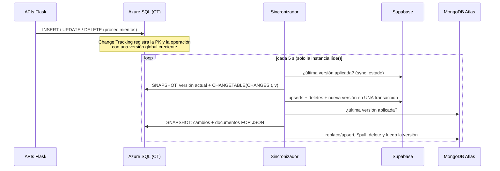

# Fases II y III — Arquitectura, base de datos y replicación

## 1. Arquitectura distribuida



| Componente | Tecnología | Ubicación |
|---|---|---|
| Portal de pacientes | Flutter Web | Archivos estáticos servidos por Nginx |
| Sistema interno | Angular | Archivos estáticos servidos por Nginx |
| APIs REST + SOAP | Flask (4 contenedores) | 2 por VM |
| Proxy inverso y TLS | Nginx | 1 por VM |
| Balanceo entre VM | Azure Load Balancer | Frente a las 2 VM |
| Base principal | Azure SQL Database | PaaS |
| Base de contingencia | Supabase (PostgreSQL) | SaaS |
| Réplica documental | MongoDB Atlas | SaaS |
| Sincronizador | Python (contenedor) | Uno en cada VM; solo uno es líder |
| Pagos | Stripe (modo prueba) | SaaS |
| Correo | Mailjet | SaaS |

**Servicios lógicos (SOA)** dentro de cada instancia Flask, como blueprints separados con su propio prefijo y contrato: `/api/citas`, `/api/pagos`, `/api/examenes` (exámenes y resultados), `/api/tratamientos`, `/api/notificaciones`, `/api/auth` y `/soap` (WSDL en `/soap?wsdl`).

**HTTPS con dos VM:** Azure Load Balancer trabaja en capa 4, así que el TLS termina en el Nginx de cada VM y ambas necesitan el certificado del dominio. Se usará el reto **DNS-01 de DuckDNS** (certbot con el plugin de DuckDNS o acme.sh), que no depende de cuál VM reciba la petición HTTP de validación.

## 2. Modelo entidad-relación



El detalle de cada columna, tipo y restricción está en [03-diccionario-datos.md](03-diccionario-datos.md), que se genera automáticamente desde la base.

### 2.1 Normalización

- **1FN:** todos los atributos son atómicos. Los exámenes de una solicitud van en `solicitud_detalle` y los valores de un resultado en `resultado_valor`; no hay listas dentro de una columna.
- **2FN:** las tablas con clave compuesta (`usuario_rol`, `rol_permiso`) no tienen atributos que dependan solo de una parte de la clave.
- **3FN:** no hay dependencias transitivas. Los datos personales están solo en `persona`; los perfiles guardan únicamente lo propio del rol (registro profesional, especialidad, tipo de sangre).
- **Desnormalización controlada y justificada:**
  - `solicitud_detalle.precio_unitario` y `resultado_valor.(unidad, rangos)` copian el valor vigente en ese momento, para que el histórico no cambie si cambia el catálogo. No es redundancia: es un dato histórico distinto.
  - `franja_horaria.ocupados` es un contador mantenido por los procedimientos. Evita contar citas en cada reserva y es el recurso que se bloquea en el escenario de concurrencia.
  - `solicitud_examen.total` se calcula al crear la solicitud.

### 2.2 Integridad

- PK `BIGINT IDENTITY` en todas las tablas, FK en todas las relaciones y `UNIQUE` en cédula, correo, códigos y registros profesionales.
- `CHECK` en estados, sexo, tipo de sangre, montos ≥ 0, fechas coherentes, `ocupados <= capacidad`, `monto_reembolsado <= monto` y JSON válido.
- **Índices únicos filtrados:**
  - un paciente no puede tener dos citas activas en la misma franja;
  - solo puede haber un pago `APROBADO` por solicitud;
  - un id de Stripe no puede repetirse.
- `rowversion` en `cita`, `solicitud_examen`, `resultado` y `pago` para la concurrencia optimista.
- Las operaciones críticas están en procedimientos almacenados con transacción y `TRY/CATCH`: `sp_registrar_paciente`, `sp_asignar_rol`, `sp_reservar_cita`, `sp_cancelar_cita`, `sp_crear_solicitud`, `sp_crear_pago`, `sp_confirmar_pago`, `sp_registrar_reembolso`, `sp_registrar_resultado`, `sp_registrar_observacion`, `sp_registrar_tratamiento` y `sp_expirar_citas_pendientes`.

## 3. Replicación y disponibilidad

### 3.1 Alternativas evaluadas

| Alternativa | ¿Detecta borrados? | ¿Se pone al día tras apagarse? | Costo / complejidad | Decisión |
|---|---|---|---|---|
| Polling por `updated_at` | No | Sí | Bajo | Descartada: pierde los DELETE |
| Triggers + tabla outbox | Sí | Sí | Medio: un trigger por tabla y limpieza del outbox | Alternativa válida |
| **Change Tracking + sincronizador propio** | **Sí** | **Sí (14 días de retención)** | **Bajo: no toca la aplicación** | **Elegida** |
| Change Data Capture (CDC) | Sí | Sí | Requiere Azure SQL S3+ o vCore | Descartada por costo |
| Debezium + Kafka | Sí | Sí | Muy alto para 2 VM pequeñas | Descartada |
| Azure SQL Data Sync | — | — | En retiro, solo SQL Server → SQL Server | No aplica |

La propuesta se contrastó con un segundo modelo (Gemini 4 Argon, por la CLI de Antigravity), que coincidió en elegir Change Tracking. De esa revisión se incorporaron las lecturas en `SNAPSHOT`, la retención de 14 días, la copia de rangos en `resultado_valor`, el `rol_actuante` en la auditoría, la expiración de citas no pagadas, la validación de conflicto de interés y el `sync_log` en ambos destinos.

### 3.2 Funcionamiento



1. **Detección:** Azure SQL guarda en Change Tracking qué filas cambiaron (`I`, `U`, `D`) y en qué versión.
2. **Lectura consistente:** el sincronizador lee la versión actual y todos los cambios dentro de una transacción `SNAPSHOT`. Así obtiene una foto coherente aunque las APIs sigan escribiendo.
3. **Transformación:**
   - **Supabase:** se copian las filas 1:1 al esquema `lab`, con las mismas PK. Las FK son `DEFERRABLE INITIALLY DEFERRED`, de modo que el orden de aplicación dentro del lote no importa.
   - **MongoDB:** el modelo relacional se convierte en documentos.
     - `resultados` lleva embebidos el paciente, el examen, el laboratorista, los valores y las observaciones médicas; lo arma SQL Server con `FOR JSON`.
     - `pagos` lleva embebidos sus reembolsos.
     - `auditoria`, `notificaciones` y `stripe_eventos` se copian tal cual.
4. **Aplicación atómica e idempotente:**
   - **Supabase:** los datos y `sync_estado.ultima_version` se guardan en la misma transacción.
   - **Mongo:** todas las operaciones son upserts o deletes por `_id`, y la versión se guarda al final. Si algo falla a mitad, el lote se repite sin duplicar.
5. **Apagado y reencendido:** cada destino recuerda su última versión. Al volver, el sincronizador pide "cambios desde la versión X" y aplica los INSERT, UPDATE y DELETE ocurridos mientras estuvo apagado. Si estuvo apagado más de 14 días (la retención), hace una **carga completa** automáticamente.
6. **Alta disponibilidad del sincronizador:** corre un contenedor en cada VM. Solo el que obtiene el candado `sp_getapplock` trabaja; si su VM cae, el candado se libera y el otro toma el relevo.
7. **Evidencia:** cada lote queda registrado en tres lugares:
   - un log JSON en la salida del contenedor (`docker logs`);
   - `lab.sync_log` en Supabase;
   - `sync_log` en MongoDB, con versión desde y hasta, upserts, deletes, detalle por tabla, duración e instancia.

**Prueba local realizada** (LocalDB → PostgreSQL y MongoDB embebidos):

| Paso | Resultado |
|---|---|
| Carga inicial | 22/22 tablas con el mismo número de filas; 41 eventos de auditoría, 4 resultados y 6 pagos en Mongo |
| Sincronizador apagado: nueva cita, cambio de teléfono, borrado de observaciones | Supabase seguía con el teléfono anterior |
| Sincronizador encendido | Versión 52 → 55; teléfono actualizado; observaciones borradas en Supabase y retiradas de los documentos de Mongo |
| Rol `lab_lectura` | Lee resultados; un UPDATE es rechazado (`read-only transaction`) |

### 3.3 Modo contingencia en las APIs

- Cada API vigila Azure SQL con un **circuit breaker**: si una consulta falla o tarda más de 3 s, el circuito se abre y las lecturas permitidas pasan a Supabase.
- En contingencia funcionan el login (lectura de `usuario`), **mis resultados**, **mis citas**, **mis tratamientos**, el catálogo y la consulta del médico.
- Toda escritura responde `503` con el mensaje "Sistema en modo contingencia: solo consulta". En contingencia no se actualiza `ultimo_login`.
- La conexión a Supabase usa el rol `lab_lectura`, que es de solo lectura incluso a nivel de PostgreSQL.
- Cada cierto tiempo el circuito prueba Azure SQL y, si responde, vuelve automáticamente a la base principal.
- La respuesta incluye la cabecera `X-Origen-Datos: azure|supabase` y el log indica qué instancia atendió.

## 4. Decisiones de servicios externos

### 4.1 Pagos: Stripe (modo prueba) frente a PayPal Sandbox

| Necesidad del proyecto | Stripe (modo prueba) | PayPal Sandbox |
|---|---|---|
| Registrar la solicitud de pago | Checkout Session o PaymentIntent | Orders API v2 |
| Recibir la confirmación | Webhook `checkout.session.completed` con firma | Webhook o captura de la orden |
| Pago rechazado | Tarjetas de prueba que fallan (`4000 0000 0000 0002` declinada, `4000 0000 0000 9995` sin fondos) | Más difícil: hay que configurar "negative testing" |
| Pago no confirmado | `checkout.session.expired` | Orden sin capturar |
| **Reembolsos** | **Sí: totales y parciales por API o Dashboard** (`charge.refunded`) | Sí: `/v2/payments/captures/{id}/refund`, totales y parciales |
| Probar webhooks en local | Stripe CLI (`stripe listen --forward-to`) | Solo con URL pública |
| Datos de tarjeta fuera de nuestro sistema | Sí (Checkout alojado) | Sí |

**Decisión: Stripe.** Cumple todo lo que pide la Fase VIII, incluidos los reembolsos, y simular rechazos es más sencillo.

**Advertencia:** Ecuador no figura entre los países donde Stripe permite **activar** cuentas reales. El **modo prueba no requiere activación**: al crear la cuenta se elige un país soportado y se trabaja solo con las claves `sk_test_` y `pk_test_`, sin dinero real. Hay que confirmarlo al crear la cuenta.

### 4.2 Correo: Mailjet

- Mailjet reemplaza a Brevo; el enunciado acepta "Brevo u otro servicio equivalente".
- El plan gratuito permite 200 correos al día.
- Se usa la API v3.1 (`POST /v3.1/send`) con un remitente verificado en Mailjet.
- Los correos salen de la tabla `notificacion`, que funciona como bandeja de salida, con reintentos y el `MessageID` de Mailjet guardado para trazabilidad. Si Mailjet falla, la operación de negocio no se pierde.

## 5. Estructura del repositorio

```
database/
  azure-sql/   01_esquema · 02_change_tracking · 03_procedimientos · 04_datos_prueba · 05_consultas · 06_seguridad
  supabase/    01_esquema_replica · 02_roles
  mongodb/     init_mongo.js
  generar_diccionario.py
sync-worker/   sincronizador Python + Dockerfile + .env.example
api/           APIs Flask (REST + SOAP, Stripe, Mailjet, PDF) + Dockerfile + .env.example
infra/         docker-compose.yml (igual en ambas VM) · nginx/ · certificado.sh (Let's Encrypt DNS-01)
clientes/      soap_cliente.py (cliente SOAP independiente)
docs/          01 análisis · 02 arquitectura y datos · 03 diccionario · 04 servicios REST/SOAP
```

Pendiente: despliegue en las VM, Azure Load Balancer, Angular, Flutter y pruebas de carga.
