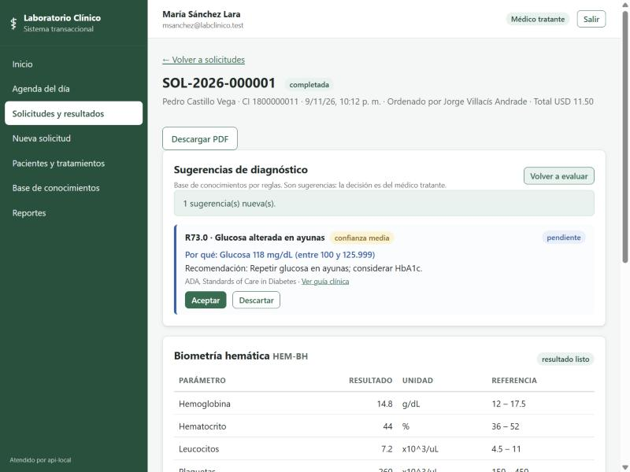
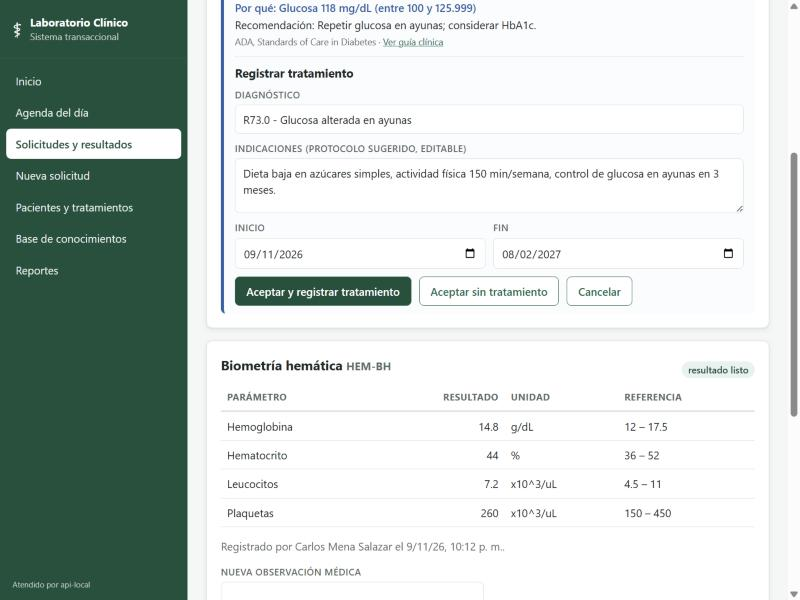
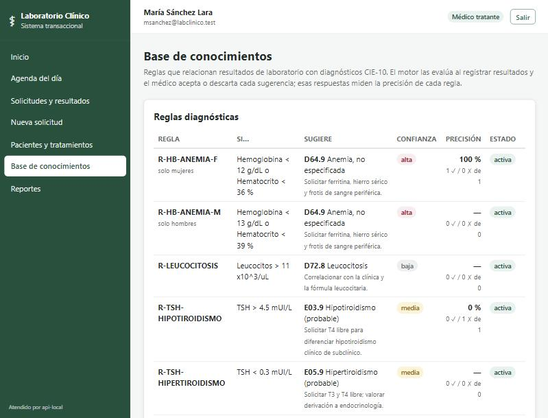

# 06 — Base de conocimientos para diagnósticos

Es un **sistema experto basado en reglas**, sin inteligencia artificial ni modelos de lenguaje. Cuando el laboratorista registra un resultado, el sistema compara los valores con reglas clínicas y **sugiere** al médico un diagnóstico presuntivo con su código CIE-10. Cada sugerencia indica qué valor la disparó, qué protocolo de tratamiento corresponde y qué guía clínica la respalda. **La decisión siempre es del médico**: acepta (y puede prescribir el tratamiento sugerido) o descarta (con un motivo). Esas respuestas miden la precisión de cada regla.

> Las reglas y guías son resúmenes académicos con valores referenciales de ADA, OMS, ESC/EAS, ATA y KDIGO. Sirven de apoyo; no sustituyen el criterio médico.

## 1. Por qué reglas y no IA (D32)

| Criterio | Reglas (elegido) | IA / LLM |
|---|---|---|
| Explicabilidad | Cada sugerencia muestra la regla y el valor exacto ("Glucosa 118 mg/dL (entre 100 y 125.9)") | Difícil de justificar ante un médico |
| Determinismo | El mismo resultado siempre da la misma sugerencia; se puede probar | Respuestas variables |
| Costo y privacidad | Sin costo por consulta; los datos clínicos no salen de la plataforma | Pago por consulta y envío de datos a terceros |
| Mantenimiento | El administrador edita reglas desde la web, sin programar | Reentrenar o rediseñar el *prompt* |

## 2. Modelo de datos (Azure SQL, `07_base_conocimiento.sql`)

```
diagnostico (CIE-10) 1──1 protocolo (indicaciones, duración)
     │1
     └──N regla_diagnostica (código, lógica TODAS/ALGUNA, sexo, edad, confianza, recomendación, fuente, guía, activa)
                 │1
                 └──N regla_condicion (parámetro del examen, operador <, <=, >, >=, ENTRE, valor, valor2)

solicitud_examen 1──N sugerencia_diagnostica N──1 regla_diagnostica
                       (explicación, estado PENDIENTE/ACEPTADA/DESCARTADA, motivo, médico, tratamiento)
```

- `UNIQUE (solicitud_id, regla_id)`: una regla sugiere una sola vez por solicitud, así que reevaluar no duplica.
- La vista `vw_precision_regla` calcula, por regla, las sugerencias aceptadas y descartadas.
- Procedimientos:
  - `sp_registrar_sugerencias` (idempotente);
  - `sp_responder_sugerencia`: valida que la sugerencia esté pendiente, que el descarte tenga motivo, que el médico no responda sobre sí mismo y que el tratamiento pertenezca al paciente;
  - `sp_guardar_regla`: crea o actualiza una regla y sus condiciones en una transacción.
- Las 5 tablas tienen **Change Tracking**. El sincronizador las replica a Supabase (`03_base_conocimiento.sql`, con RLS), así que en contingencia el médico sigue **viendo** las sugerencias.
- Las **guías clínicas** son documentos de estructura libre (criterios y secciones), por eso viven en **MongoDB Atlas** (`laboratorio.guias_clinicas`, `database/mongodb/guias_clinicas.js`). Cada regla las cita con `guia_clave`.

## 3. Reglas cargadas

| Regla | Condición | Diagnóstico sugerido | Confianza |
|---|---|---|---|
| R-GLU-ALTERADA | Glucosa entre 100 y 125.9 mg/dL | R73.0 Glucosa alterada en ayunas | Media |
| R-GLU-DIABETES | Glucosa ≥ 126 mg/dL | E11 Diabetes mellitus tipo 2 (confirmar) | Media |
| R-HB-ANEMIA-F | Mujer: Hb < 12 **o** Hto < 36 | D64.9 Anemia | Alta |
| R-HB-ANEMIA-M | Hombre: Hb < 13 **o** Hto < 39 | D64.9 Anemia | Alta |
| R-LIP-COLESTEROL | Colesterol > 240 **o** LDL > 160 | E78.0 Hipercolesterolemia | Media |
| R-LIP-TRIGLICERIDOS | Triglicéridos > 200 | E78.1 Hipertrigliceridemia | Media |
| R-TSH-HIPOTIROIDISMO | TSH > 4.5 | E03.9 Hipotiroidismo | Media |
| R-TSH-HIPERTIROIDISMO | TSH < 0.3 | E05.9 Hipertiroidismo | Media |
| R-RENAL | Creatinina > 1.3 **y** urea > 45 | N28.9 Alteración renal | Alta |
| R-LEUCOCITOSIS | Leucocitos > 11 | D72.8 Leucocitosis | Baja |
| R-PCR-ELEVADA | PCR > 10 | R79.8 Marcador inflamatorio elevado | Baja |

## 4. Funcionamiento

1. El laboratorista registra un resultado (`POST /api/examenes/.../resultados`).
2. Después de `sp_registrar_resultado`, la API ejecuta el motor:
   - Toma los valores de **todos** los resultados de la solicitud, junto con el sexo y la edad del paciente.
   - Evalúa las reglas activas. Una regla con lógica `TODAS` exige que se cumplan todas sus condiciones; con `ALGUNA`, basta una. Una condición sobre un parámetro sin valor no se cumple.
   - Registra las sugerencias nuevas.
   - Es *best-effort*: si el motor falla, el resultado ya quedó guardado y la respuesta incluye `sugerencias_nuevas`.
3. El médico abre la solicitud en Angular y ve el panel **Sugerencias**, ordenado por confianza. Ahí puede:
   - **Aceptar y prescribir:** abre el formulario de tratamiento, rellenado con el protocolo; al guardarlo, la sugerencia queda ACEPTADA y enlazada al tratamiento.
   - **Aceptar sin tratamiento.**
   - **Descartar con motivo.**
   - **Ver la guía** (MongoDB) o **reevaluar**.
4. En la página **Base de conocimientos** (médico y administrador) se ven las reglas, sus condiciones y su **precisión** (aceptadas / respondidas). El administrador puede crear reglas y activarlas o desactivarlas.

### Endpoints (`/api/conocimiento`)

| Método | Ruta | Roles | Uso |
|---|---|---|---|
| GET | `/sugerencias?solicitud_id=` · `?paciente_id=` | Médico, laboratorista, admin | Sugerencias con explicación y protocolo |
| POST | `/evaluar/<solicitud_id>` | Médico, laboratorista, admin | Reevalúa (idempotente) |
| POST | `/sugerencias/<id>/responder` | Médico | `{"aceptar": bool, "motivo", "tratamiento_id"}` |
| GET | `/reglas` | Médico, admin | Reglas, condiciones y precisión |
| POST | `/reglas` | Admin | Crea o actualiza una regla (valida operadores y `ENTRE` con `valor2`) |
| PATCH | `/reglas/<id>` | Admin | `{"activa": bool}` (auditado) |
| GET | `/diagnosticos` | Médico, laboratorista, admin | Catálogo CIE-10 con protocolo |
| GET | `/guias/<clave>` | Médico, laboratorista, admin | Guía clínica desde MongoDB |

Errores de negocio:

| Código SQL | HTTP | Caso |
|---|---|---|
| 50081, 50082 | 404 | La solicitud o la sugerencia no existe |
| 50083 | 409 | La sugerencia ya fue respondida |
| 50084 | 422 | Descarte sin motivo |
| 50085 | 403 | Un médico no puede responder sugerencias sobre sí mismo |
| 50086 | 403 | El tratamiento no pertenece al paciente |
| 50080, 50087, 50088 | 422 | JSON inválido o regla sin condiciones |

## 5. Pruebas

- **Local** (LocalDB + PostgreSQL y MongoDB embebidos): **25/25**. Cubre el motor como función pura (límites de `ENTRE`, sexo, edad, lógica), el registro idempotente, las respuestas del médico, los permisos, la réplica y las guías.
- **En la nube** (`python pruebas/base_conocimiento.py`): **18/18**.
  - El motor evaluó 8 solicitudes con resultados y generó 6 sugerencias; por ejemplo, R73.0 por "Glucosa 118 mg/dL (entre 100 y 125.9)".
  - Reevaluar no creó ninguna sugerencia nueva.
  - Las reglas se muestran con su precisión, los diagnósticos con su protocolo, y la guía `diabetes` llega desde Atlas.
  - El médico descartó una sugerencia; responderla otra vez dio 409.
  - Permisos: 403 para médico y laboratorista donde no corresponde, 401 sin token, 422 para una regla inválida.
  - Réplica en Supabase igual a Azure en las 5 tablas.
- `pruebas/verificar_replicacion.py` ahora compara **27 tablas**.

| | |
|---|---|
|  <br/>Sugerencia con explicación, protocolo y guía |  <br/>Aceptar: tratamiento rellenado con el protocolo |
|  <br/>Reglas con su precisión | |
